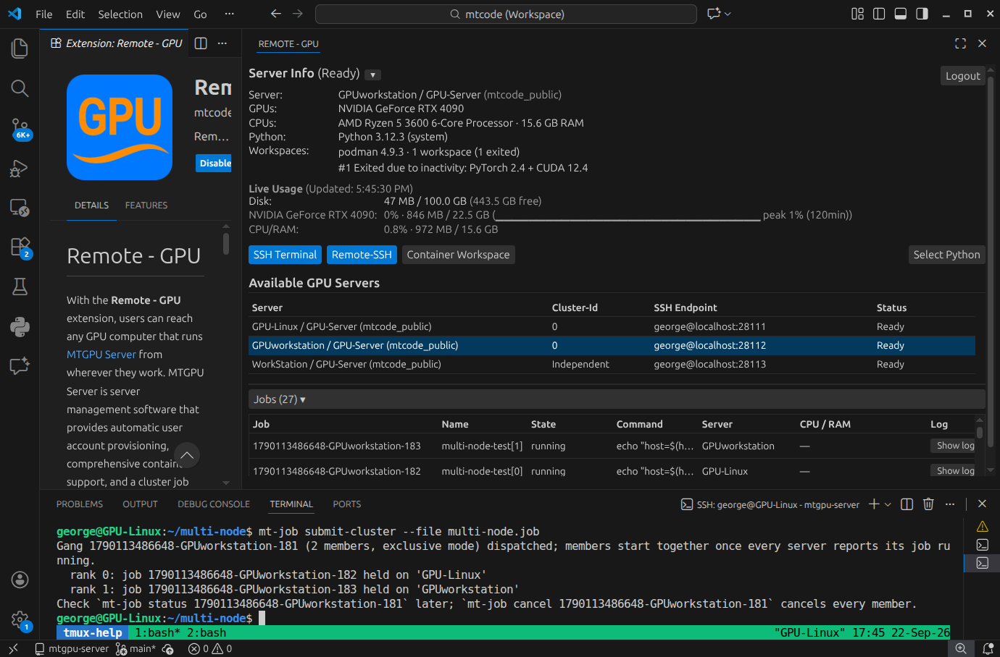

# Remote - GPU

> **Preview release.** This extension connects to computers running [MTGPU Server](https://mtcodeai.com/platform/gpu-server.html). The MTGPU Server download is coming soon on mtcodeai.com; until then the extension is usable only with servers an administrator has already set up.

The **Remote - GPU** extension lets many users share remote GPU computers running [MTGPU Server](https://mtcodeai.com/platform/gpu-server.html) across different private networks, with no VPN, network, or firewall configuration. MTGPU Server provisions a tenant account for each user automatically, with the same UID and GID on every server, so home directories and storage can be shared seamlessly. It manages anything from a single server to a cluster of thousands of servers and users with the same simple configuration, and comes with a built-in job scheduler and rich container support. The extension provides a uniform view of the available servers with the live usage of each, one-click access to an SSH terminal, and integration with the Remote-SSH and Dev Containers extensions.

*The panel lists the available GPU servers and shows the selected server's details, live disk and GPU usage, and the **Remote-SSH** / **SSH Terminal** / **Container Workspace** / **Select Python** action buttons.*

## One Interface for Every GPU Server

Sign in once and the panel lists every GPU server you are authorized to use — even when they belong to different administrators.

- **User account provisioned automatically** — on first connection to any server, the MTGPU Server creates an unprivileged OS account for the user and sets up SSH key access automatically, no password required.
- **Select a server to work on** — see the server's identity, hardware, workspaces, and live usage. Access the server with a one-click SSH terminal, open a new window with the Remote-SSH extension, or attach to a workspace with the Microsoft Dev Containers extension.
- **Work on multiple servers simultaneously** — select another server to work on; all existing SSH terminals, Remote-SSH windows, and Dev Containers windows remain open.
- **Submit jobs and manage workspaces** — in an SSH terminal, use `mt-job` to submit jobs to the server or to the cluster scheduler, including multi-node jobs for distributed training and array jobs for parameter sweeps; use `mt-container` to create, start, stop, or remove container workspaces.
- **Work from anywhere on the Internet** — both the MTGPU servers and the client are location independent, and each can stay in a private network behind a firewall without VPN or any network or firewall configuration. All communications travel over [DirectLink](https://mtcodeai.com/platform/platform.html) with P2P direct connection and end-to-end encryption.

## Getting Started

1. Create an [administrator account](https://mtcodeai.com/platform/get-started.html) and invite users to join.
2. Install the [MTGPU Server](https://mtcodeai.com/platform/gpu-server.html) on any computer and sign in with the administrator account.
3. Install this extension in VS Code and sign in with a user account.

## Requirements

- **Client:** VS Code 1.74+ on Windows, macOS, or Linux.
- **Host:** MTGPU Server on Linux or Windows WSL2.

## Learn More

- [MTGPU Server — full product overview](https://mtcodeai.com/platform/gpu-server.html)
- [How MTCode DirectLink works](https://mtcodeai.com/platform/platform.html)
- [MTCodeAI.com](https://mtcodeai.com)

---

© 2026 BrightTime Technologies, Inc. All rights reserved.
