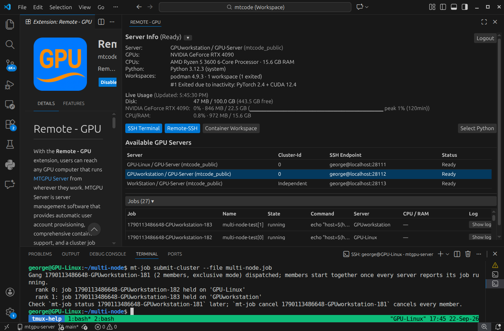

# Remote - GPU

> **Preview release.** This extension connects to computers running [MTGPU Server](https://mtcodeai.com/platform/gpu-server.html). The MTGPU Server download is coming soon on mtcodeai.com; until then the extension is usable only with servers an administrator has already set up.

**Remote - GPU** brings every [MTGPU Server](https://mtcodeai.com/platform/gpu-server.html) you are authorized to use into one VS Code panel. Compare hardware and live resource usage, monitor cluster jobs, open persistent SSH terminals, launch Remote-SSH, and create or attach to rootless container workspaces with Dev Containers.

MTGPU Server turns existing workstations and cloud hosts into shared, multi-tenant GPU infrastructure. One simple configuration file controls how each server operates independently and as part of a cluster, while cluster members discover one another automatically. MTGPU provisions user accounts and SSH keys on first access, keeps user identities consistent across servers, and schedules native and containerized jobs with automatic failover.

*The panel shows authorized servers, selected-server hardware and live resource usage, active and queued jobs, and one-click actions for **SSH Terminal**, **Remote-SSH**, **Container Workspace**, and **Select Python**.*

## One Panel for Every Authorized GPU Server

Sign in once to discover every GPU server shared with your account—even when the servers belong to different administrators.

- **Compare servers and live capacity** — view each server's hardware, workspaces, disk usage, and current GPU, CPU, and memory utilization.
- **Connect your way** — open a persistent SSH terminal, launch a Remote-SSH window, attach to a workspace with Dev Containers, or select a server-side Python environment.
- **Work on several servers at once** — switching the selected server leaves existing terminals, Remote-SSH windows, and Dev Containers windows open.
- **Create and manage container workspaces** — use rootless container workspaces for interactive development, with the user's home directory and persistent caches mounted.
- **Submit and monitor jobs** — use `mt-job` from an SSH terminal to submit native or containerized jobs, including multi-node jobs for distributed training and array jobs for parameter sweeps, then follow their status in the panel.

## What MTGPU Server Handles

- **Automatic account access** — on first connection, MTGPU Server creates a private, unprivileged OS account and configures passwordless SSH key access. Existing OS accounts continue to work unchanged.
- **Consistent user identities** — each tenant keeps the same UID and GID across MTGPU servers, allowing home directories and shared storage to retain consistent file ownership.
- **Built-in scheduling and failover** — the scheduler places native and containerized jobs across available servers, replicates its queue, and recovers automatically if the scheduler node goes offline. No separate Slurm or Kubernetes installation is required.
- **Private connectivity from anywhere** — servers and clients remain on private networks. [DirectLink](https://mtcodeai.com/platform/platform.html) establishes direct connections whenever the network permits, uses a self-hosted relay as fallback, and keeps connections end-to-end encrypted.

## Getting Started

### For Administrators

1. Create an [administrator account](https://mtcodeai.com/platform/get-started.html) and invite users.
2. Install and configure [MTGPU Server](https://mtcodeai.com/platform/gpu-server.html) on one or more supported hosts.

### For Users

1. Accept the administrator's invitation.
2. Install Remote - GPU in VS Code.
3. Sign in to discover the servers shared with your account.

## Requirements

- **Client:** VS Code 1.74+ on Windows, macOS, or Linux.
- **Host:** MTGPU Server on Linux or Windows WSL2.

## Learn More

- [MTGPU Server — full product overview](https://mtcodeai.com/platform/gpu-server.html)
- [User manual](https://mtcodeai.com/platform/user-manuals.html)
- [How MTCode DirectLink works](https://mtcodeai.com/platform/platform.html)
- [MTCodeAI.com](https://mtcodeai.com)

---

© 2026 BrightTime Technologies, Inc. All rights reserved.
